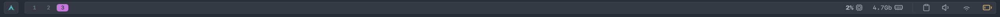
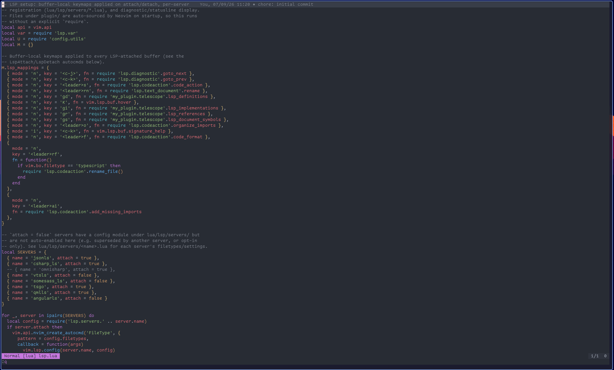

# dotfiles

Personal configuration for a Wayland desktop built on [niri](https://github.com/YaLTeR/niri) (scrolling-tile compositor) and [Quickshell](https://quickshell.outfoxxed.me/) (status bar/shell), themed mostly from a shared One Dark palette (`themerc`), with `IoskeleyMono Nerd Font Mono` as the primary terminal/editor font.

This directory is expected to live at (or be symlinked from) `~/env/config`, exported as `$CONFIG_PATH`. Several configs (niri binds, scripts) reference `$CONFIG_PATH` directly, so that env var must be set before niri starts.

Theme colors live outside this repo in `~/env/dotfiles/rc/themerc`, which exports `THEME_*` variables. They must also be in the environment niri starts from, since Quickshell reads them directly (see [Theming](#theming)).

## Screenshots

| niri | Quickshell | nvim |
|---|---|---|
|  |  |  |

## Layout

| Path | What it is |
|---|---|
| [`niri/`](niri/README.md) | Window manager config — binds, layout, animations, window/layer rules, startup scripts |
| [`quickshell/`](quickshell/README.md) | Desktop shell (QML) — pill-style topbar, wallpaper, notifications, clipboard popup |
| [`nvim/`](nvim/README.md) | Neovim config — `vim.pack`-based plugin management, LSP, custom UI |
| `kitty/` | Terminal emulator config — `kitty.conf` includes `current-theme.conf` (OneDark-Pro); `dark-theme.auto.conf` (Catppuccin Mocha) is picked up automatically by kitty when the OS prefers dark; `themes/catppuccin/mocha.conf` is a spare copy not referenced by `kitty.conf` |
| `foot/` | Terminal emulator config — `foot.ini` (IoskeleyMono, runs as `foot --server` and opened with `footclient`), which includes `colors.ini`, generated from the `colors.ini.in` template by `niri/scripts/theme.sh`; plus a `minimal_foot.ini` variant (Macon font, default colors) bound separately in niri |
| `wofi/` | App launcher — `wofi` (config: style path, `term=kitty`, `Alt-j`/`Alt-k` navigation) and `style.css` |
| `mpv/` | Video player config — `mpv.conf` (only `fs=yes` active), a fully commented `input.conf`, plus stock reference files (`mplayer-input.conf`, `restore-*-bindings.conf`, `encoding.rst`, `tech-overview.txt`) |
| `flameshot/` | `flameshot.ini` — only sets `useGrimAdapter=true` so Flameshot works under Wayland (niri floats it at the top-left); not bound to a key |
| `satty/` | Screenshot annotation tool config (`config.toml`: brush tool on start, `wl-copy`, saves to `~/Pictures/Screenshots/`) — used by niri's screenshot bind |
| `yazi/` | Terminal file manager config (`yazi.toml`, `keymap.toml`, `theme.toml`) and bundled flavors (Catppuccin Frappé/Latte/Macchiato/Mocha, Dracula) — `theme.toml` selects `dracula` for both dark and light |
| `chromium-flags.conf` | Flags for Chromium/Electron apps under Wayland (Ozone, PipeWire screen capture, plus `--process-per-site` and background-throttling/networking tweaks) |
| `screenshots/` | Images used in this README (`niri.png`, `quickshell.png`, `nvim.png`) |

See each subdirectory's own README for details — `niri`, `quickshell`, and `nvim` are the largest pieces and are documented in depth.

## Theming

The shared palette is `~/env/dotfiles/rc/themerc` (outside this repo), which exports `THEME_*` color variables (One Dark by default). It reaches each app in one of two ways:

- **Rendered templates** — `niri/scripts/theme.sh` sources themerc and runs `envsubst` over `niri/config/*.kdl.in` (currently `layout.kdl.in` → `layout.kdl`: focus ring `THEME_PRIMARY`/`THEME_SELECTION`, border `THEME_PRIMARY`/`THEME_BG`/`THEME_DANGER`) and `foot/colors.ini.in` → `foot/colors.ini` (with the `#` stripped, since foot wants `RRGGBB`). niri runs the script at startup; re-run it by hand after editing themerc. niri reloads its config right away, and foot picks up new colors in new terminals. Edit the `.in` files, not the generated ones.
- **Environment at runtime** — Quickshell's `config/Theme.qml` reads `THEME_*` via `Quickshell.env()`, with One Dark fallbacks.

Not wired to themerc (colors still hardcoded per app):

- **One Dark** — kitty (`current-theme.conf`, OneDark-Pro)
- **Catppuccin Mocha** — kitty's `dark-theme.auto.conf` (applied automatically in OS dark mode)
- **Dracula**-ish purples (`#bd93f9`, `#282a36`, `#44475a`) — wofi, yazi (`dracula` flavor)

Fonts: **IoskeleyMono Nerd Font Mono** in foot, kitty, and Neovide; Quickshell uses `SFMono Nerd Font` (`config/Fonts.qml`). Exceptions: satty still uses Comic Code, `minimal_foot.ini` uses Macon, and wofi uses Cascursive.

## Key apps wired together

- Screenshots: `Print` in niri → `wayfreeze` + `grim` + `slurp` → `satty` (annotate) → clipboard/file
- Clipboard history: `wl-paste` watchers (started by niri) → `cliphist` → Quickshell clipboard panel (`Mod+C` runs `qs ipc call clipboard toggle`; the old wofi picker is commented out)
- Launcher: `wofi --show drun` (`Mod+D`)
- Terminals: `foot --server` is started by niri; `Mod+Return` opens `footclient` (uses `foot.ini`), `Mod+Shift+Return` opens a standalone `foot` with `minimal_foot.ini`, and `Mod+B` opens `kitty`
- Screen sharing: niri's `scripts/desktop-portal` sets up `xdg-desktop-portal`; `chromium-flags.conf` enables PipeWire capture in Chromium-based apps

## Notes

- `nvim/swap/` may exist locally with leftover `.swp` files from past sessions, but it is gitignored (`nvim/.gitignore`) and not part of the repo — swapfile writing itself is disabled in the nvim config.
- `mpv/mpv.conf` is largely the stock example config with most options commented out; only `fs=yes` is active. `mpv/input.conf` is likewise entirely commented out.
