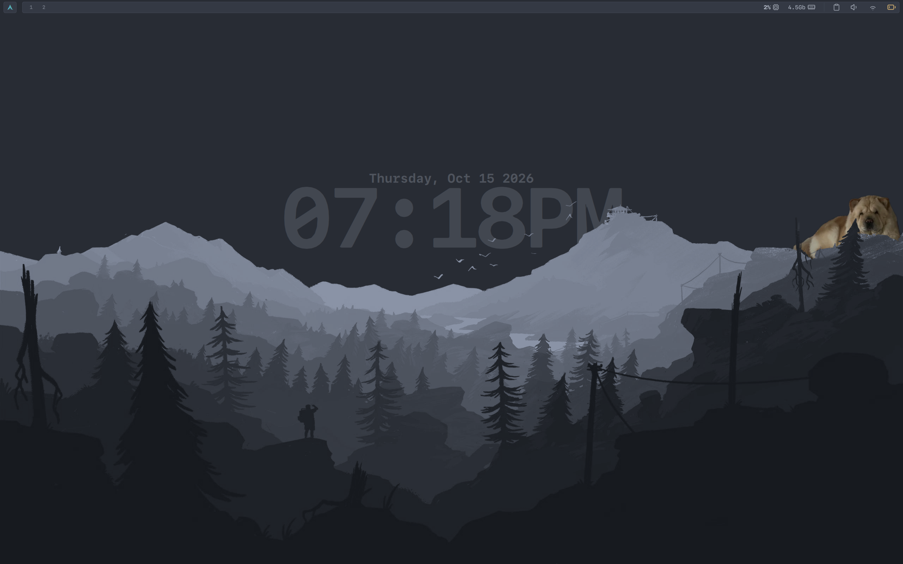

# niri config

Personal [niri](https://github.com/YaLTeR/niri) window manager configuration, with colors rendered from the shared `themerc` palette (One Dark magenta `#c678dd` accent by default).



## Layout

```
config.kdl              # entry point, includes everything below + startup commands
config/
  environments.kdl      # environment variables for spawned apps (MOZ_ENABLE_WAYLAND=1)
  input.kdl             # keyboard, touchpad, mouse, trackpoint settings
  output.kdl            # monitor (eDP-1) resolution/scale/position
  layout.kdl.in         # template for layout.kdl — edit this one (${THEME_*} colors)
  layout.kdl            # generated: gaps, column widths, focus ring, border, shadow
  binds.kdl             # keybindings
  gestures.kdl          # touchpad gestures / hot corners
  animations.kdl         # animation settings
  hotkey-overlay.kdl     # "important hotkeys" popup behavior
  window-rule.kdl        # per-app window rules (floating, sizing, corners)
  layer-rule.kdl        # layer-shell rules (Quickshell wallpaper in backdrop)
  overview.kdl          # workspace overview appearance
scripts/
  theme.sh               # renders *.kdl.in and foot/colors.ini.in from themerc
  term.sh                # picks the working directory for new terminals
  desktop-portal         # restarts xdg-desktop-portal for screen sharing/capture
  video-record.sh        # wf-recorder region-recording toggle (not bound to a key)
```

## Startup

On launch, `config.kdl` spawns:
- `scripts/theme.sh` — renders the color templates from themerc (see below)
- `qs` — status bar (Quickshell)
- `foot --server` — so `Mod+Return` can open terminals with `footclient`
- `scripts/desktop-portal` — sets up the correct xdg-desktop-portal backend for screen sharing
- `dbus-update-activation-environment --systemd WAYLAND_DISPLAY XDG_CURRENT_DESKTOP` — so xdg-desktop-portal-hyprland gets the required variables
- `wl-paste` watchers piping into `cliphist` for text and image clipboard history (max 25 items each)

Wallpaper spawn is currently commented out (`wbg`).

## Key bindings

Mod is Super.

**Apps**
| Bind | Action |
|---|---|
| `Mod+Return` | Terminal (`footclient`, connects to the foot server) |
| `Mod+Shift+Return` | Terminal (foot, minimal config) |
| `Mod+B` | Terminal (kitty) |
| `Mod+D` | App launcher (wofi) |
| `Mod+C` | Clipboard history (Quickshell popup, via `qs ipc`) |
| `Mod+P` | Color picker (`niri msg pick-color` → hex to clipboard) |
| `Print` | Region screenshot (wayfreeze + grim + slurp + satty) |

New terminals open in the directory reported by `scripts/term.sh` (defaults to `$HOME`, or a saved path in `~/Documents/Temp/whereami`).

**Focus / move windows**
| Bind | Action |
|---|---|
| `Mod+Left/Down/Up/Right` or `Mod+H/J/K/L` | Focus column/window |
| `Mod+Ctrl+Left/Down/Up`, `Mod+Shift+H/J/K/L` | Move column/window (no `Mod+Ctrl+Right`) |
| `Mod+Home` / `Mod+End` | Focus first/last column |
| `Mod+Ctrl+Home` / `Mod+Ctrl+End` | Move column to first/last |
| `Mod+Shift+Left/Down/Up/Right` | Focus monitor |
| `Mod+Shift+Ctrl+Left/Down/Up/Right` or `Mod+Shift+Ctrl+H/J/K/L` | Move column to monitor |
| `Mod+WheelScrollLeft/Right`, `Mod+Shift+WheelScrollUp/Down` | Focus column left/right |
| `Mod+Ctrl+WheelScrollLeft/Right`, `Mod+Ctrl+Shift+WheelScrollUp/Down` | Move column left/right |

**Workspaces**
| Bind | Action |
|---|---|
| `Mod+U` / `Mod+I` (or `Page_Down`/`Page_Up`, `WheelScrollDown`/`Up`) | Focus workspace down/up |
| `Mod+Ctrl+U` / `Mod+Ctrl+I` (or `Page_Down`/`Page_Up`, `WheelScrollDown`/`Up`) | Move column to workspace down/up |
| `Mod+Shift+U` / `Mod+Shift+I` (or `Page_Down`/`Page_Up`) | Move workspace down/up |
| `Mod+1`–`9` | Focus workspace N |
| `Mod+Ctrl+1`–`9` | Move column to workspace N |

**Window management**
| Bind | Action |
|---|---|
| `Mod+O` | Toggle overview |
| `Mod+W` | Close window |
| `Mod+BracketLeft/Right` | Consume/expel window left/right |
| `Mod+Comma` / `Mod+Period` | Consume into / expel from column |
| `Mod+R` / `Mod+Shift+R` | Cycle preset column width (fwd/back) |
| `Mod+Ctrl+Shift+R` / `Mod+Ctrl+R` | Cycle/reset preset window height |
| `Mod+F` | Maximize column |
| `Mod+Shift+F` | Fullscreen window |
| `Mod+M` | Maximize window to edges |
| `Mod+Ctrl+F` | Expand column to available width |
| `Mod+Ctrl+C` | Center visible columns |
| `Mod+Minus/Equal` | Adjust column width -/+10% |
| `Mod+Shift+Minus/Equal` | Adjust window height -/+10% |
| `Mod+V` | Toggle floating |
| `Mod+Shift+V` | Switch focus between floating/tiling |

**System**
| Bind | Action |
|---|---|
| `Mod+Shift+Slash` | Show hotkey overlay |
| `Mod+Escape` | Toggle keyboard shortcut inhibitor |
| `Mod+Shift+E` / `Ctrl+Alt+Delete` | Quit (with confirmation) |
| `Mod+Shift+P` | Power off monitors |
| Volume / mic mute / media / brightness keys | Handled via `wpctl`, `playerctl`, `brightnessctl` |

## Window rules

- All windows: 5px rounded corners, clipped to geometry.
- `foot`, `kitty`: rules present but empty (`open-maximized` is commented out).
- `com.gabm.satty` (screenshot annotator): opens floating, 400–1000×200–900.
- `mpv`: opens floating, 400–1300×200–1000.
- `thunar`: opens floating at 50%×50%.
- `flameshot`: opens floating and focused, at the top-left corner.

## Layout / theming

- 8px gaps, `center-focused-column "never"`, preset column widths 1/3, 1/2, 2/3, default column width 1/2.
- Focus ring 2px, active `THEME_PRIMARY`, inactive `THEME_SELECTION`.
- Border disabled by default (2px, active `THEME_PRIMARY`, inactive `THEME_BG`, urgent `THEME_DANGER` when enabled).
- Transparent background, shadows configured (softness 30, spread 5, offset y=5, `#0007`) but disabled by default.
- `prefer-no-csd` is set; screenshots save to `~/Pictures/Screenshots/`.
- Overview workspace shadow is off; the Quickshell wallpaper layer (`quickshell:my-wallpaper`) is placed in the overview backdrop.
- Hot corners are disabled.

## Theme colors

`config/layout.kdl` is generated — edit `config/layout.kdl.in` instead. `scripts/theme.sh` sources `~/env/dotfiles/rc/themerc` and runs `envsubst` (limited to `THEME_MAGENTA`, `THEME_PRIMARY`, `THEME_SELECTION`, `THEME_BG`, `THEME_DANGER`) over every `config/*.kdl.in`, writing the file next to it without the `.in`. It also renders `foot/colors.ini`. niri runs it at startup, and you can run it by hand after changing themerc; niri reloads its config as soon as the file changes.

## Dependencies

Referenced by binds/scripts/startup: `foot`/`footclient`, `envsubst` (gettext, for `theme.sh`), `kitty`, `wofi`, `wayfreeze`, `grim`, `slurp`, `satty`, `cliphist`, `wl-paste`/`wl-copy`, `wpctl`, `playerctl`, `brightnessctl`, `qs` (Quickshell), `xdg-desktop-portal-hyprland`/`xdg-desktop-portal`, `killall` (for `desktop-portal`), `dbus-update-activation-environment`, `wf-recorder` + `slurp` (for `video-record.sh`).

## Notes

- Output config in `config/output.kdl` targets a laptop panel `eDP-1` at `2560x1600@60`, scale 1, position `x=1280 y=0`; adjust for your hardware (`niri msg outputs` lists connected displays).
- `$CONFIG_PATH` is expected to be set in the environment and point at the parent of this `niri/` directory (e.g. `~/env/config`), since binds reference `$CONFIG_PATH/foot/...`, `$CONFIG_PATH/niri/scripts/...`, etc.
